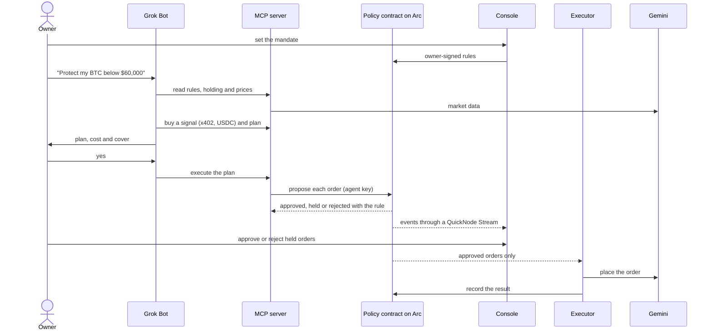

# Mandate

An AI agent that hedges your crypto on prediction markets, inside rules it cannot break.

Built for the UBC 2026 Hackathon: track **Agentic Payments & AI**, **Best use of Arc**, and the **Gemini Prediction Markets**, **Grok Bot** and **QuickNode Streams** bounties.


## The idea

You hold crypto and you want protection against a drop, but you do not want to hand an AI agent your exchange account and hope.

With Mandate you write the rules once, in a Policy contract on Arc: a total budget, a maximum trade size, an approval threshold, a daily loss limit, the market categories allowed, and a pause switch.
That set of rules is the **mandate**.

The agent (Grok Bot) then does the work.
It reads your holding, reads the Gemini prediction-market ladder for that asset, buys a pricing signal for a fraction of a cent, and plans a hedge.
Every order it wants to place is first proposed to the contract, which answers with one of three verdicts:

- **approved**: the executor may place the order;
- **held**: the order waits for your approval in the console;
- **rejected**: the order is refused, with the rule that stopped it recorded onchain.

The agent's key can only propose.
It cannot approve its own orders, change a rule, unpause, or touch the exchange key, and no prompt can talk it past the contract.

## How it fits together



One order, start to finish.
The agent talks only to the MCP server, the MCP server can only propose, and nothing reaches the exchange without the contract's approval.

| Folder | What it is |
| --- | --- |
| `contracts/` | The Policy contract (Solidity, Foundry). |
| `agent/` | The remote MCP server Grok Bot connects to: the agent's only way to act. |
| `planner/` | The hedge planner: turns a holding and a price floor into a ladder of orders. |
| `gemini/` | A read-only client for Gemini's public prediction-market data. |
| `signals/` | The paid signal API (x402, Circle Nanopayments on Arc). |
| `streams/` | The QuickNode Stream: filter, configuration, management script, payload parser. |
| `dashboard/` | The owner's console (Next.js). |
| `brand/` | Design tokens and the two self-hosted fonts, shared by every web app. |
| `devchain/` | A local chain with Arc's chain id, the simulated executor, and `npm run dev:stack`. |
| `redteam/` | A scripted adversary that attacks the mandate through the MCP server and with the agent key. |
| `shared/` | Types, the contract ABI, the TypeScript copy of the rules, and the API contracts between services. |
| `docs/` | Design notes and verified findings for each integration. |

## The agent's decision loop

Grok Bot works through 16 tools on the MCP server.
The server sends it the order of work on every connection (`agent/src/instructions.ts`), and every tool result names who acts next.

1. **Check setup** (`get_setup_state`).
   If a step is missing, the agent says exactly what it is and who must do it.
2. **Read the rules and the holding** (`get_policy`, `get_portfolio`).
   The rules and today's usage come from the contract; the holding is what the owner entered in the console, valued at Gemini spot.
3. **Read the market** (`get_ladder`).
   A ladder is a set of contracts such as "BTC $63,000 or above", one per strike, for one expiry.
   Buying NO on a strike pays $1 per contract if the price ends below it, which is what offsets the loss on the holding.
4. **Buy a signal** (`buy_signal`).
   The agent pays the signal API $0.001 in USDC over x402 for a cheap, fair or expensive rating of every strike, so the plan buys underpriced protection first.
5. **Plan** (`plan_hedge`).
   The planner sizes NO orders between the owner's floor and the current price, within the maximum cost the owner gave, and predicts the verdict each order will get.
6. **Ask the owner.**
   The agent shows the cost, the share of the loss covered, what is not covered, and which orders will wait for approval, then waits for a yes.
7. **Propose** (`execute_plan`, or `propose_trade` for one order).
   Each order goes to the contract with a hash of the agent's reasons.
   The run stops at the first rejection.
8. **Report** (`get_intent`, `get_activity`).
   Approved, waiting, rejected with the rule and the numbers, and filled.

If the owner wants a rule changed, the agent can only file a request (`request_policy_change`).
The owner sees it in the console as a diff and applies it with their own wallet, or does not.

## Safety limits

Enforced by the contract, for every proposal, whatever the agent says or is told:

| Rule | Demo value |
| --- | --- |
| Total budget across all open and filled orders | $200 |
| Maximum size of one trade | $25 |
| Trades above this amount wait for the owner | $20 |
| Daily loss limit, after which trading stops for the day | $40 |
| Allowed market categories | Crypto only |
| Pause switch: one transaction stops all new trades | off |

Three roles, three keys: the **owner** sets rules and approves, the **agent** only proposes, the **executor** only places approved orders and records results.
A stolen agent key gives an attacker nothing beyond what the mandate already allows.
The red team (`npm run redteam`) attacks that claim and records what it finds in [redteam/REPORT.md](redteam/REPORT.md): with a stolen key the attacker cannot change a rule or role, but can keep selling once the budget is used, and can get intents approved that the contract does not check (a mislabelled category, any limit price, any market or outcome text).
The executor refuses to trade those intents, the console flags them, and neither the console nor the MCP server acts on, or breaks on, the text or numbers they carry.

Enforced by the MCP server, as a second layer:

- The category of a market is taken from Gemini, never from the agent's input.
- A repeated proposal within 10 minutes returns the first result instead of trading twice.
- A plan can be executed for 30 minutes, then it must be planned again from fresh prices.
- Signal purchases have a daily budget ($0.02) and a maximum price per purchase ($0.005), both checked before anything is signed.
- Market titles and other third-party text are marked untrusted, and the agent is told never to follow instructions found in them.
- Bearer token on every request, rate limits, body size limits and a time budget per tool call.
- No tool calls an owner or executor function; a test proves it from the source (`agent/test/no-owner-calls.test.ts`).

Every proposal also carries a **sealed reason**: the request, the prices the agent saw, the signal it bought and the plan it followed, stored in the console under its keccak256 hash.
The console recomputes the hash when it shows the reason, so a rewritten explanation is detected.

## Grok Bot

Grok Bot is the agent.
It connects to our remote MCP server as a custom connector and uses its tools to read the mandate, plan a hedge, pay for a signal and propose trades, in a normal chat with the owner or in a scheduled routine with nobody watching.
It holds no keys and has no direct access to the exchange or the contract; the connector is its only way to act, and the contract judges every action.
The instruction text, the skill and the routine are in `agent/grok/`, and everything we verified about Grok Bot's connector behaviour is in [docs/grok-bot.md](docs/grok-bot.md).

## QuickNode Streams

The console's live feed is designed around a QuickNode Stream on **Arc Testnet** (`arc-testnet`, chain id 5042002) using the **Logs** dataset.
A JavaScript **filter** ([streams/filter.js](streams/filter.js)) runs on QuickNode's side for every batch of blocks, keeps only the logs emitted by our Policy contract, and returns them as a compact envelope with the batch's block range.
The **destination** is a webhook on the console (`/api/webhooks/quicknode`), which verifies each delivery's `X-QN-Signature` (HMAC-SHA256 over nonce, timestamp and body), rejects stale timestamps, decodes the Policy events, stores them idempotently by transaction hash and log index, and pushes them to the browser over server-sent events.

The Stream is core, not decoration: the activity feed, the approval queue, the audit trail and the scorecard are all built from these events alone, and a slow RPC poll only fills gaps.
The Stream is created, paused and priced by [streams/scripts/quicknode-stream.ts](streams/scripts/quicknode-stream.ts) through the Streams REST API, with a credit budget check before it will activate.
The full design is in [docs/quicknode-streams.md](docs/quicknode-streams.md).

## x402 payments

The agent pays for what it uses.
`signals/` sells a hedge signal at `GET /v1/signal/hedge`: for one Gemini ladder it compares each strike's NO price with a fair value from realised volatility and rates it cheap, fair or expensive.
The price is $0.001, paid in USDC over **x402** with **Circle Nanopayments on Arc**: the agent signs a transfer authorization offchain, Circle Gateway verifies it, and many payments settle later in one batch transaction, so neither side pays gas per request.

The spend is capped three ways:

- a daily budget and a maximum price per purchase on the MCP server, checked before the payment is signed and kept in an append-only ledger that survives restarts;
- a hard cap passed to the payment client for each request;
- the buyer wallet's Gateway balance, which the server never tops up.

Requests the seller cannot serve are refused for free, before any payment.
Each payment's receipt id is part of the sealed reason of the trades it informed.
Details and a recorded paid run are in [docs/x402.md](docs/x402.md).

## Run it

You need Node.js 22 or newer and git.
Foundry (anvil and forge) is installed from npm with the other dependencies.

```sh
git clone https://github.com/DoctorFlu/UBC.git
cd UBC
npm ci                 # use ci, not install: it keeps the lockfile's native bindings intact
npm run mcp:token      # writes MCP_AUTH_TOKEN into .env without printing it
npm run x402:keygen    # writes the signal buyer and seller keys into .env, prints only addresses
npm run dev:stack      # chain, signal API, console, MCP server and simulated executor
```

Open http://localhost:3000.
The stack runs a local chain with Arc's chain id, deploys the Policy contract with the demo rules above, and wires every service to it.
The owner signs with a built-in test wallet, so no browser wallet is needed.

Then:

1. In the console, open **Hedge** and enter a holding, for example 0.05 BTC.
2. To let the agent buy signals, fund the buyer address that `x402:keygen` printed with Arc testnet USDC at https://faucet.circle.com, then, with the stack running, run `npm run x402:hello` once to deposit 1 USDC into Circle Gateway.
   Without this step everything else works and the agent plans without a signal.
3. In a second terminal run `npm run dev:tunnel`.
   It prints a public HTTPS address for the MCP server.
4. In Grok Bot, open **Connect apps**, add a custom connector with that address ending in `/mcp`, and an `Authorization` header of `Bearer ` followed by the token from `.env`.
   The steps are in [agent/README.md](agent/README.md#connect-grok-bot).
5. Ask Grok Bot: "Protect my BTC below $60,000 for at most $50."
   The first time, it gives you a pairing link; open it and confirm in the console.
   It then plans, asks for your yes, and proposes the orders.
6. Watch the console: approved orders fill, an order above $20 waits for your approval, and an order above $25 is rejected with its rule.

Without Grok Bot, `npm run mcp:e2e` drives the same tools end to end with a scripted client, and `npm run dev:propose -- --amount 30` proposes a single trade as the agent.

### Checks

```sh
npm run check     # lint, format, types and unit tests
npm run mcp:e2e   # the agent flow against a real local chain, both contract variants
npm run e2e       # the console in a real browser against a real local chain
npm run redteam   # a scripted adversary attacks the mandate, both contract variants
```

Configuration is described in [docs/configuration.md](docs/configuration.md).
Every secret lives in `.env`, which is git-ignored.

### Host it

[docs/hosting.md](docs/hosting.md) runs the whole product on one small Linux VM with `docker compose up -d`, behind Caddy with automatic HTTPS, with Grok Bot connecting to `https://<host>/mcp`.

## What is real today

| Piece | State |
| --- | --- |
| Policy contract and rules | Real contract; runs on the local devchain in this setup, deployment on Arc testnet is in progress. |
| Grok Bot through the MCP server | Live: a real Grok Bot plans and proposes through the connector. |
| Gemini market data | Live, public endpoints, read only. |
| x402 signal payments | Live on Arc testnet with testnet USDC through Circle Gateway. |
| Console | Live against the chain; any view not yet backed by a real source is marked "Sample data" on screen. |
| QuickNode Stream | Filter, configuration, management script and verified webhook receiver are in the repo; the Stream is switched on once the contract is on Arc testnet. |
| Order placement on Gemini | Simulated: the local executor checks each approved intent against Gemini's listing, records a fill for the valid ones and marks it "Simulated fill", and records the rest as not filled. No real order is placed. |
