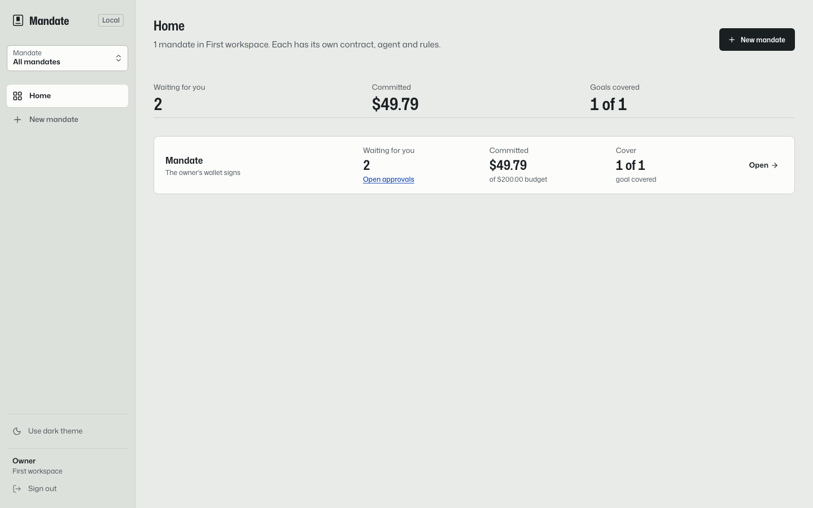
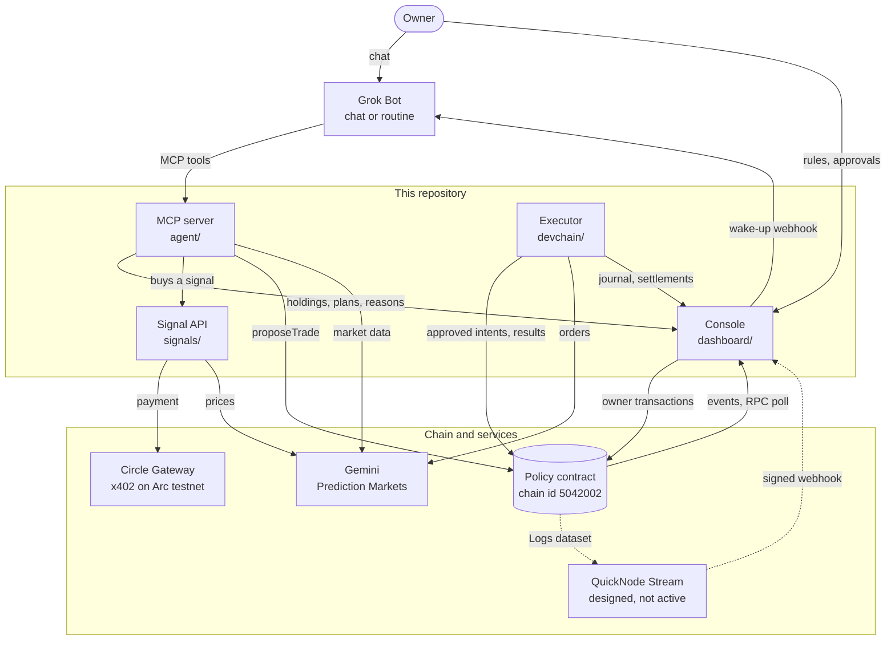
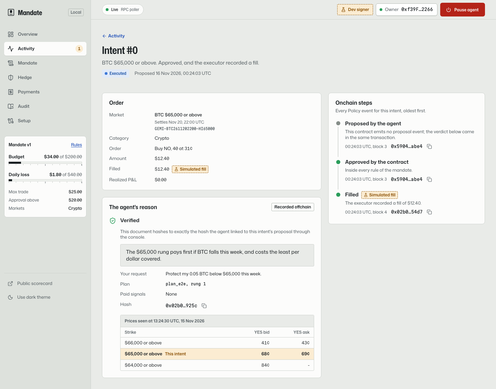

# Mandate

Mandate lets an AI agent hedge your crypto holding on Gemini's prediction markets inside rules you set once in a Policy contract.
The agent, Grok Bot, plans the hedge, pays a fraction of a cent for a pricing signal, and proposes each order to the contract.
The contract approves the order, holds it for your approval, or rejects it with the rule that stopped it, and the agent's key cannot do anything else.

Built for the UBC 2026 Hackathon: track **Agentic Payments & AI**, **Best use of Arc**, and the **Gemini Prediction Markets**, **Grok Bot** and **QuickNode Streams** bounties.



## Hosted demo

- App: https://8080-agq6mxapjuxoy3aavoouae6yri.instabox.tech, the console, and the MCP server at `/mcp`.
- Site: https://8081-agq6mxapjuxoy3aavoouae6yri.instabox.tech, the landing page.

The hosted demo runs on **Arc testnet** since 18 November 2026, against our own instance of the Policy contract, [`0x9a240b2aaa2a936DBf4543940341Bb725C92412d`](https://explorer.testnet.arc.io/address/0x9a240b2aaa2a936DBf4543940341Bb725C92412d) (deploy block 72777078), in gateway mode as described in [docs/hosting.md](docs/hosting.md#arc-testnet).
It is built from the same source, `contracts/src/Policy.sol`, and `npm run arc:doctor` checks its code byte for byte against that build ([docs/configuration.md](docs/configuration.md#our-own-instance-or-the-teams)).
The team's first deployment, `0x571D…82f3` in [contracts/README.md](contracts/README.md), is the same contract; ours exists so that its roles name the stack's own keys.
The console needs a passkey sign-in, and a workspace there is opened with a code from the operator ([docs/accounts.md](docs/accounts.md#sign-in)).
Two pages need no sign-in: the landing page, and the agent's public scorecard at [`/agent/0x2fa2cE1F4780014414207e544C1057B05809a82E`](https://8080-agq6mxapjuxoy3aavoouae6yri.instabox.tech/agent/0x2fa2cE1F4780014414207e544C1057B05809a82E), which the landing page links to.

<!-- #96 (members, roles and hosted sign-up): when it is merged, say here how a visitor signs up on the hosted demo. -->

## How it fits together



The agent talks only to the MCP server, the MCP server can only propose, and nothing reaches Gemini without the contract's approval.
The dotted edges are the QuickNode Stream, which is built and tested but not yet switched on (see [What is real and what is simulated](#what-is-real-and-what-is-simulated)).

| Folder | What it is |
| --- | --- |
| `contracts/` | The Policy contract (Solidity, Foundry). |
| `agent/` | The remote MCP server Grok Bot connects to: the agent's only way to act. Its Grok Bot skill and routine are in `agent/grok/`. |
| `planner/` | The hedge planner: turns a holding and a price floor into a ladder of orders, and measures the cover already held. |
| `gemini/` | Clients for Gemini's public prediction-market data and, for the executor only, its signed order API. |
| `signals/` | The paid signal API (x402, Circle Gateway on Arc testnet). |
| `streams/` | The QuickNode Stream: filter, configuration, management script, payload parser. |
| `dashboard/` | The owner's console (Next.js). |
| `site/` | The public landing page. |
| `brand/` | Design tokens and the two self-hosted fonts, shared by every web app. |
| `devchain/` | A local chain with Arc's chain id, the executor, and `npm run dev:stack`. |
| `redteam/` | A scripted adversary that attacks the mandate through the MCP server and with the agent key. |
| `shared/` | Types, the contract ABI, the TypeScript copy of the rules, and the API contracts between services. |
| `deploy/` | Docker Compose and Caddy files for the hosted demo. |
| `docs/` | Design notes and verified findings for each integration (see [Docs map](#docs-map)). |

## The life of one hedge

The owner has entered a holding in the console, for example 0.05 BTC, and saved a Grok Bot routine with a standing goal such as "keep it protected below $60,000, spending at most $50 per plan".

1. **Wake-up.**
   The routine runs every hour, and also when the console posts a `mandate.wake` event to its webhook, for example when the spot price falls below the goal's floor.
   [agent/grok/routine.md](agent/grok/routine.md), [docs/event-wake.md](docs/event-wake.md), [docs/grok-bot.md](docs/grok-bot.md#routines)
2. **Read the state.**
   The Bot calls `get_setup_state`, `get_policy` and `get_activity` on the MCP server: whether setup is complete, the rules and today's usage from the contract, and what happened since the last run.
   [agent/README.md](agent/README.md)
3. **Plan, and check the cover.**
   `plan_hedge` sizes NO orders on the nearest Gemini ladder between the floor and the current price.
   The server first counts the protection already held on that ladder, so a goal that is already met answers `ALREADY_COVERED` and nothing is bought.
   [docs/cover.md](docs/cover.md)
4. **Buy a signal.**
   `buy_signal` pays the signal API $0.001 in USDC over x402 for a cheap, fair or expensive rating of each strike, and the Bot plans again with the signal's receipt.
   [docs/x402.md](docs/x402.md#hedge-signal-issue-20-and-buy_signal-issue-21)
5. **Propose.**
   `execute_plan` re-reads the cover before each order and proposes it to the Policy contract with the agent key and the hash of a sealed reason (the request, the prices seen, the signal and the plan).
   The contract answers each proposal with a verdict: approved, held for the owner, or rejected with its rule.
   [docs/order-lifecycle.md](docs/order-lifecycle.md#1-proposal-and-verdict), [docs/contract-interface.md](docs/contract-interface.md)
6. **The owner decides what is held.**
   An order above the approval threshold waits in the mandate's Approvals page until the owner approves or rejects it.
   On a mandate whose contract the console deployed, the console holds that contract's owner key: one passkey prompt confirms the decision, and the console signs and sends the call.
   On the first mandate, and on a contract deployed from a wallet, the owner's wallet signs it.
   [docs/order-lifecycle.md](docs/order-lifecycle.md#1-proposal-and-verdict), [docs/accounts.md](docs/accounts.md#owner-actions-and-the-passkey)
7. **The console follows the chain.**
   The console stores every Policy event and builds the activity feed, approvals and audit trail from them.
   [docs/quicknode-streams.md](docs/quicknode-streams.md)
8. **Fill.**
   The executor sees the approval, refuses any intent the venue could not trade, places the order, and records the fill onchain with `recordResult`.
   On Gemini, the order is sized so its cost and Gemini's fee fit the approved amount.
   [docs/order-lifecycle.md](docs/order-lifecycle.md#2-fill), [docs/gemini-venue.md](docs/gemini-venue.md#what-the-executor-does-with-an-approved-intent)
9. **Settlement.**
   When the ladder expires, the executor waits for Gemini to publish the outcome, then signs a settlement (cost, fee, payout, net) and stores it in the console.
   The console wakes the routine once for the settled ladder, and the Bot reports what it cost and paid, then plans on the next ladder.
   [docs/order-lifecycle.md](docs/order-lifecycle.md#4-settlement)



## What is real and what is simulated

| Piece | State today |
| --- | --- |
| Chain and Policy contract | **Real, on the hosted demo**: Arc testnet (chain id 5042002), our instance of the contract from `contracts/` at [`0x9a240b2aaa2a936DBf4543940341Bb725C92412d`](https://explorer.testnet.arc.io/address/0x9a240b2aaa2a936DBf4543940341Bb725C92412d), deployed in [`0xd254165e...e0b81ff0`](https://explorer.testnet.arc.io/tx/0xd254165ef9972a8d9c5656d9d4f4d4f61ee95d4c9b30629159458ce3e0b81ff0) (block 72777078). The team's first deployment of the same contract is [`0x571D8ea7C86c80a230C10818743f8861084F82f3`](https://explorer.testnet.arc.io/address/0x571D8ea7C86c80a230C10818743f8861084F82f3) (block 72740419). Locally, `npm run dev:stack` runs the same contract on an anvil chain with Arc testnet's chain id. |
| Onchain transactions | **Real Arc testnet transactions**, paid in testnet USDC: the agent's proposals (agent [`0x2fa2...a82E`](https://explorer.testnet.arc.io/address/0x2fa2cE1F4780014414207e544C1057B05809a82E)), the owner's approvals, rule changes and pause from the owner's own browser wallet, and the executor's `recordResult` (executor [`0x0F7e...4390`](https://explorer.testnet.arc.io/address/0x0F7e3266fda16E0655E1817c98B7B0b0ada44390)). |
| Order placement | **On Gemini's sandbox, with test funds, on the hosted demo since 18 November 2026 (14:28 UTC)**: each approved intent is placed as a limit order on Gemini's sandbox (`EXECUTOR_VENUE=gemini`), and its fill, full or partial, is recorded with `recordResult` on Arc testnet. The first hedge placed that way was intents #9 to #12. Before the switch the executor checked each approved intent against Gemini's listing, recorded a simulated fill, and placed no order; those fills (intents #0 to #7) keep their "Simulated fill" label. The console and the agent label every fill from the venue the executor announced, never from the chain, and say "Fill source unknown" until the executor has announced one; the console's venue badge names the venue in use. |
| Sandbox liquidity | **Mirrored, where the operator runs the mirror maker**: Gemini's sandbox has no counterparties on the ladders it quotes, so our mirror maker, on a second sandbox account, rests orders at the best bids Gemini's production exchange shows for the same contracts, at production's sizes, capped. Prices are real, matching and settlement are the sandbox's own, and the counterparty is ours ([docs/gemini-venue.md](docs/gemini-venue.md#the-mirror-maker)). The console says so, in the venue badge's details, only where the deployment declares it with `SANDBOX_LIQUIDITY=mirror-maker`; a fill itself says only that it was on Gemini's sandbox, with test funds. |
| Gemini sandbox run | Measured on 17 November 2026 ([docs/gemini-venue.md](docs/gemini-venue.md#what-a-sandbox-demo-can-show)): $9.73 approved at 97c, 10 contracts placed and filled at 0.97, a fee of $0.03 equal to the estimate, and at expiry a payout of $10.00, net +$0.27 after fees, matching the sandbox balance to the cent. |
| Gemini market data | Gemini's public endpoints, read only. |
| x402 signal payments | Arc testnet with testnet USDC through Circle Gateway. A paid run on 15 November 2026 bought one signal for 0.001 USDC, settled in batch transaction [`0xa99bcd21...41e5ec12b`](https://explorer.testnet.arc.io/tx/0xa99bcd21ab5a60c3749c1c9fcb743768e6cffb5513a3dd7d3ab87d541e5ec12b) ([docs/x402.md](docs/x402.md#a-paid-run-of-the-hedge-signal)). |
| QuickNode Stream | The filter, configuration, management script and signed webhook receiver are in the repository and tested; no Stream has been created or activated yet ([docs/quicknode-streams.md](docs/quicknode-streams.md)). The owner approved the credits for demo windows; until a window starts, the console reads Policy events by RPC poll from Arc's public RPC. |
| Grok Bot | A real Grok Bot plans and proposes through the connector ([docs/grok-bot.md](docs/grok-bot.md#verified-by-hand-issue-4)). |
| Console sign-in | Passkeys (WebAuthn) for each workspace member ([docs/accounts.md](docs/accounts.md)). |

### The three demo cases, on Arc testnet

Every verdict is a transaction on the hosted demo's contract, readable on the explorer:

| Case | What the contract did | Transaction |
| --- | --- | --- |
| A trade inside the rules | `IntentApproved`, then the executor filled it and called `recordResult` | [`0x7bc1cf5e…576d85`](https://explorer.testnet.arc.io/tx/0x7bc1cf5e618539734be88622814d113edb9a897bbaba407d048e88e560576d85) |
| A trade that breaks a rule | `IntentRejected` with the reason `over max trade size` | [`0x0f80ccb8…c3f195`](https://explorer.testnet.arc.io/tx/0x0f80ccb81676db9713690265657318c6e0e0c46dff0c4c85c352e53b26c3f195) |
| A trade above the approval threshold | `IntentNeedsApproval`; it waited for the owner's wallet | [`0x020cda1f…7d3f73`](https://explorer.testnet.arc.io/tx/0x020cda1fe5d0bd4d7baeda987efc3dee22a2323da86f4bb05f8ee75a2f7d3f73) |

The contract's source is verified on the explorer, so the rule behind each verdict can be read next to the transaction.

## Safety model

- **Rules onchain.**
  The Policy contract checks every proposal against a total budget, a maximum trade size, an approval threshold, a daily loss limit, the allowed categories and a pause switch.
  The demo rules are a $200 budget, $25 per trade, approval above $20, a $40 daily loss limit and Crypto only (`DEMO_POLICY` in `devchain/src/deploy.ts`).
  One limit of this demo: the daily loss rule is on-chain and tested, but the executor records a fill with a zero profit or loss and records settlement losses off-chain (signed, in the console), so the rule does not trigger here. An on-chain `recordSettlement` is the planned fix ([docs/contract-interface.md](docs/contract-interface.md#24-recordsettlement-issue-92)).
- **Three keys.**
  The owner sets rules and approves, the agent only proposes, and the executor only places approved orders and records results.
  No MCP tool calls an owner or executor function, and `agent/test/no-owner-calls.test.ts` proves it from the source.
- **The server computes cover.**
  The MCP server counts the protection already held and re-checks it before each order, so repeated or overlapping runs do not buy the same protection twice ([docs/cover.md](docs/cover.md)).
- **Held versus rejected.**
  An order above the approval threshold is held until the owner decides; an order that breaks a rule is rejected, with the rule recorded onchain, and the agent is told never to work around it.
- **Passkeys.**
  Console members sign in with passkeys ([docs/accounts.md](docs/accounts.md)).
  On a contract the console deployed, every owner action (approving or rejecting an intent, setting rules, resuming the agent) and every new agent token needs a fresh passkey confirmation, never the session alone.
  The passkey signs a single-use, 2-minute challenge that the server binds to the member, the workspace, the mandate's contract and chain, and the exact call with its arguments, so it confirms that one action and no other; a pause needs only the session, so stopping the agent never waits on a device.
  On the first mandate and on a contract deployed from a wallet, the owner's wallet signs owner calls itself ([docs/accounts.md](docs/accounts.md#owner-actions-and-the-passkey)).
- **A token per agent.**
  Each agent reaches the MCP server with its own bearer token, which acts on that agent's mandate only, is stored as a hash, and can be revoked in the console ([docs/accounts.md](docs/accounts.md#how-each-request-is-scoped)).
  A workspace runs up to 5 mandates by default (`CONSOLE_MANDATES_PER_WORKSPACE`), each with its own contract, agent, agent key and tokens, rules, approvals and records, under its own address (`/m/<mandate id>/...`).
  A token reaches only its own agent's mandate, and one executor key serves every mandate's contract, each with its own order journal ([docs/accounts.md](docs/accounts.md#the-model)).
- **A second layer in the MCP server.**
  The market category comes from Gemini, never from the agent; a repeated proposal within 10 minutes returns the first result (`agent/src/state/ledger.ts`); a plan can be executed for 30 minutes (`agent/src/state/plans.ts`); signal spend is capped at 0.02 USDC a day and 0.005 USDC a purchase by default ([docs/configuration.md](docs/configuration.md#x402-signal-api-circle-nanopayments-on-arc-testnet)); third-party text is marked untrusted.
- **The executor checks again.**
  It refuses any approved intent the MCP server could not have sent (not a Gemini symbol, a limit outside 1 to 99, a category Gemini disagrees with), and places one order per intent at most ([docs/gemini-venue.md](docs/gemini-venue.md#safety-rules)).
- **Red team.**
  `npm run redteam` attacks the mandate through the MCP server and with a stolen agent key.
  Against the `production` contract it ran 47 attacks: 42 held, 5 bounded, 0 breaches ([redteam/REPORT.md](redteam/REPORT.md)).
  The bounded ones are listed there with their limits: for example, splitting an order gets past the per-order rules but not the budget.

## How the sponsor technologies are used

**Arc.**
The Policy contract is written for Arc, where gas is paid in USDC ([docs/contract-interface.md](docs/contract-interface.md)); the hosted demo runs on Arc testnet itself, and the local chain uses Arc testnet's chain id, 5042002.
The x402 payments for signals settle on Arc testnet, and the QuickNode Stream is configured for Arc testnet.

**Circle Gateway and x402.**
The agent pays for each signal it uses: the signal API answers `402 Payment Required`, the MCP server signs a USDC transfer authorization offchain, and Circle Gateway verifies it and settles many payments later in one batch transaction on Arc testnet.
The spend is capped by a daily budget and a price cap per purchase on the MCP server, a hard cap per request in the payment client, and the buyer's Gateway balance, which the server never tops up.
Each payment's receipt id is part of the sealed reason of the orders it informed ([docs/x402.md](docs/x402.md)).

**QuickNode Streams.**
The Stream is designed as the console's source of Policy events on **Arc testnet** (network `arc-testnet`) with the **Logs** dataset.
Its **filter**, [streams/filter.js](streams/filter.js), runs on QuickNode's side and keeps only the Policy contract's logs.
Its **destination** is the console's webhook, `/api/webhooks/quicknode`, which verifies the `X-QN-Signature` HMAC, refuses stale deliveries, and stores each event once by transaction hash and log index.
It is core because the activity feed, the approval queue, the audit trail, the scorecard and the Bot's wake-ups are all built from these events, and the Stream and the RPC poller end in the same function ([docs/event-wake.md](docs/event-wake.md)).
No Stream is active yet; [streams/scripts/quicknode-stream.ts](streams/scripts/quicknode-stream.ts) creates, pauses and prices it, and [docs/quicknode-streams.md](docs/quicknode-streams.md) has the design and the credit budget.

**Gemini.**
Gemini's public prediction-market data gives the ladders the planner sizes, each market's category, and the prices the signal rates.
The executor places approved orders through Gemini's signed order API on the sandbox, never on production from the demo setup, and settles each position from the outcome Gemini publishes ([docs/gemini-venue.md](docs/gemini-venue.md)).

**Grok.**
Grok Bot is the agent: it connects to the MCP server as a custom connector and uses its tools to read the mandate, plan a hedge, pay for a signal and propose orders, in a chat with the owner or in a scheduled or webhook-started routine.
It holds no keys and has no direct access to Gemini or the contract, so the contract judges everything it does.
The instruction text, the skill and the routine are in `agent/grok/` ([docs/grok-bot.md](docs/grok-bot.md)).
The full chat with the Bot, from the first connector test to the settled sandbox hedge, is exported in [docs/grok-bot-chat-export.pdf](docs/grok-bot-chat-export.pdf) (as text: [docs/grok-bot-chat-export.md](docs/grok-bot-chat-export.md)).

## Run it locally

You need Node.js 22 or newer and git.
Foundry (anvil and forge) is installed from npm with the other dependencies.

```sh
git clone https://github.com/DoctorFlu/UBC.git
cd UBC
npm ci                 # use ci, not install: it keeps the lockfile's native bindings intact
npm run mcp:token      # writes MCP_AUTH_TOKEN into .env without printing it
npm run x402:keygen    # writes the signal buyer and seller keys into .env, prints only addresses
npm run dev:stack      # chain, signal API, console, MCP server, executor and landing page
```

These commands were run on a clean clone on 17 November 2026 (macOS on Apple silicon, Node.js 26.13.1, npm 11.20.0).
The stack uses ports 3000 (console), 3001 (landing page), 8545 (chain), 8787 (MCP server) and 8788 (signal API), and stops if one is taken.
It deploys the Policy contract with the demo rules on a local chain with Arc's chain id, and the executor is simulated.
When it is ready it prints a one-time claim code.

1. Open http://localhost:3000/claim, enter the code and your name, and make a passkey.
   Save the recovery code it shows.
   The owner signs contract transactions with a built-in test wallet, so no browser wallet is needed.
2. In the console, open **Hedge** and enter a holding, for example 0.05 BTC.
3. Optional: to let the agent buy signals, fund the buyer address that `x402:keygen` printed with Arc testnet USDC at https://faucet.circle.com, then, with the stack running, run `npm run x402:hello` once to deposit 1 USDC into Circle Gateway.
   Without this step the agent plans without a signal.
4. In a second terminal, run `npm run dev:tunnel`; it prints a public HTTPS address for the MCP server.
5. In Grok Bot, open **Connect apps** and add a custom connector with that address ending in `/mcp` and an `Authorization` header of `Bearer ` followed by a token you create in the console under **Setup**, **Agents** ([agent/README.md](agent/README.md#connect-grok-bot)).
6. Ask Grok Bot: "Protect my BTC below $60,000 for at most $50."
   The first time, it gives you a pairing link to confirm in the console; then it plans, asks for your yes, and proposes the orders.

Without Grok Bot, `npm run mcp:e2e` drives the same tools end to end with a scripted client, and `npm run dev:propose -- --amount 30` proposes one trade as the agent.

```sh
npm run check     # lint, format, types and unit tests
npm run mcp:e2e   # the agent flow against a real local chain, both contract variants
npm run e2e       # the console against a real local chain, then the landing page, in a real browser
npm run redteam   # a scripted adversary attacks the mandate, both contract variants
```

Every setting is in [docs/configuration.md](docs/configuration.md), and every secret lives in `.env`, which git ignores.
[docs/hosting.md](docs/hosting.md) runs the whole product on one Linux VM with `docker compose up -d`.

## Docs map

| Document | What it covers |
| --- | --- |
| [docs/accounts.md](docs/accounts.md) | Workspaces, members, passkey sign-in, sessions, agent tokens, and how each request is scoped to one mandate; several mandates per workspace, where each contract comes from, the passkey on owner actions, the shared executor, and the blockers before real funds. |
| [docs/configuration.md](docs/configuration.md) | Every environment variable, by service. |
| [docs/contract-interface.md](docs/contract-interface.md) | What the offchain code uses from the Policy contract, the requested additions, and the red team's findings for the contract owner. |
| [docs/cover.md](docs/cover.md) | How the server decides that a protection goal is already met, and plans only the missing part. |
| [docs/event-wake.md](docs/event-wake.md) | Which events wake Grok Bot's routine, the event body, and the limits on wake-ups. |
| [docs/gemini-venue.md](docs/gemini-venue.md) | Orders on Gemini's sandbox: safety rules, fees, settlement, the journal, and what was verified. |
| [docs/grok-bot.md](docs/grok-bot.md) | How Grok Bot connects to the MCP server, its skills and routines, and what was verified by hand. |
| [docs/grok-bot-chat-export.md](docs/grok-bot-chat-export.md) | The whole chat with Grok Bot, 15 to 18 Nov 2026, unedited (also as [PDF](docs/grok-bot-chat-export.pdf)). |
| [docs/hosting.md](docs/hosting.md) | Running the product on one VM with Docker Compose and Caddy, including the InstaBox gateway mode. |
| [docs/order-lifecycle.md](docs/order-lifecycle.md) | One order from proposal to settlement, and who owns each step. |
| [docs/quicknode-streams.md](docs/quicknode-streams.md) | The QuickNode Stream on Arc testnet: dataset, filter, webhook, lifecycle and credit budget. |
| [docs/x402.md](docs/x402.md) | x402 with Circle Gateway on Arc testnet: the seller, the buyer, the hedge signal and a recorded paid run. |

<!-- #96: add its docs here when it is merged. -->
