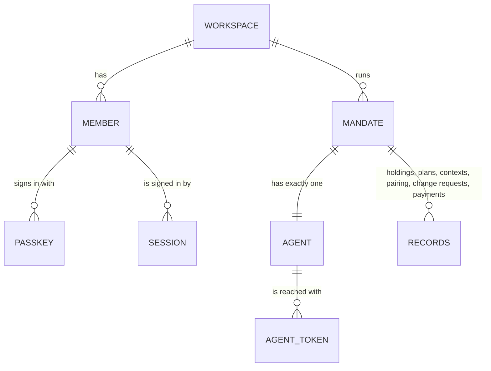

# Accounts

Mandate is a multi-user product: people sign in to their own workspace with a passkey, and each agent reaches its own mandate with its own token.
This page describes the model, how each request is scoped, the threat model, and how a production deployment should hold keys and secrets.
It covers phase 1 of 3 (issue #94); phase 2 (#95) adds several mandates per workspace and phase 3 (#96) adds members and roles.

## The model

- A **workspace** is the unit of isolation: nothing is readable or writable across workspaces.
- A **member** belongs to one workspace and signs in with one or more **passkeys**.
  Phase 1 has one member per workspace; the `role` column exists (every member is `admin`) so phase 3 is additive.
- A **mandate** is one Policy contract with its rules, its holding and exactly one agent, because the contract has one `user`, one `agent` and one `executor` (`docs/contract-interface.md`).
  "Several agents" therefore means several mandates.
  Phase 1 keeps one mandate per workspace, but every record, route and token lookup is keyed by mandate.
- An **agent** has its own onchain key and one or more **agent tokens**.
  A token is what an MCP client presents as `Authorization: Bearer <token>`; it decides which agent, and so which mandate, a call acts on.
- **Records** the console keeps (holdings, decision contexts, hedge plans, intent-to-context links, pairing, change requests, signal payments and budget) carry the mandate they belong to.
  The Policy event cache stays keyed by deployment, because events are public chain data; a mandate names the deployment it follows.

### Where the contract comes from

A mandate's `deployment` says which Policy contract it follows:

- `env`: the contract the server is configured with (`POLICY_ADDRESS`, or the devchain or demo chain deployment file).
  Exactly one mandate can follow it: the first one, which the migration creates from the single-tenant data.
- none: the mandate has no contract yet.
  Its console shows "no Policy contract" and its agent's tools answer `unavailable`.
  Phase 2 adds the "New mandate" flow that deploys a contract and records its address, chain and deploy block in the same row.

### Agent keys and the signer interface

Every agent key sits behind one interface, `AgentSigner` in `@mandate/shared`: an address and `signTransaction`.
Callers never see a key.

- **Console key store** (`console` signer): the console creates the key when it creates the agent, and stores it with envelope encryption.
  A random 256-bit data key encrypts the private key with AES-256-GCM; the master key encrypts the data key with AES-256-GCM; both bind the agent id as additional data, so a ciphertext cannot be moved to another agent.
  The MCP server never holds these keys: it asks the console to sign, over the private network, with the service token and the agent id.
  The console signs only a transaction to its mandate's Policy contract, on its chain, calling `proposeTrade`, with no value, so even a compromised MCP server cannot make an agent key do anything an agent cannot already do.
- **Server key** (`env` signer): the key the MCP server is configured with (`AGENT_PRIVATE_KEY`, or the demo chain's agent).
  It signs for the first mandate's agent, so the live hosted agent keeps working after the upgrade.

A KMS, an HSM or a custody provider replaces the console key store by implementing `AgentSigner` behind the same signing route; nothing that proposes changes.

### Tokens and codes

| Secret | Made by | Shown | Stored as | Lifetime |
| --- | --- | --- | --- | --- |
| Agent token (`mdt_` and 43 characters, 256 bits) | the owner, in Setup, Agents | once | SHA-256 | until revoked |
| Env-file token (`MCP_AUTH_TOKEN`) | the operator, on the server | never by the console | SHA-256, registered by the MCP server | until revoked in the console |
| Session id (256 bits) | the console, at sign-in | never (cookie only) | SHA-256 | 30 days, or 7 days unused |
| Claim code (120 bits) | the operator, with `console:admin claim-code` | once, in the operator's terminal | SHA-256 | 24 hours, single use |
| Invite code (120 bits) | the operator, with `console:admin invite` | once, in the operator's terminal | SHA-256 | 7 days, single use |
| Recovery code (120 bits) | the console, after a passkey is registered | once | SHA-256 | until used; a new one is shown then |

Every secret is high-entropy, so a plain SHA-256 is enough and lookups are by hash.
A lookup by hash leaks nothing about the secret through timing: an attacker cannot choose inputs whose hashes approach a stored one.
Where a secret is compared rather than looked up (the env-file token, the service token), the comparison hashes both sides and uses `timingSafeEqual`.

## Sign-in

Sign-in is a passkey (WebAuthn), with no password, no email and nothing secret stored on the server: a passkey's public key, its id and its counter.
The server side uses `@simplewebauthn/server` and the browser side `@simplewebauthn/browser`.
User verification is required, and passkeys are discoverable, so signing in asks for nothing but the passkey.

- **Claim** (`/claim`): the first workspace holds the data that existed before accounts.
  The operator runs `console:admin claim-code` on the server; it prints a one-time code once and stores only its hash.
  Whoever enters the code and registers a passkey becomes that workspace's member.
  Until then nobody can see the workspace's data.
- **Sign-up** (`/sign-up`): creates a new workspace with one mandate (no contract yet) and its agent.
  In production it needs an invite code from `console:admin invite`; in local development it is open unless `CONSOLE_SIGNUP=invite`.
- **Sign-in** (`/sign-in`): one button, which asks the browser for a passkey of this site.
- **Recovery** (`/recover`): the recovery code shown after sign-up or claim signs the member in once and asks for a new passkey; using it shows a new code.
  A member can also add a second passkey in Setup, so losing one device does not lock them out.
- **Sign-out** ends the session on the server and clears the cookie.

The relying party id and origin come from settings: the origin is `CONSOLE_URL` and the relying party id its host name, unless `CONSOLE_WEBAUTHN_RP_ID` names a parent domain.
That works on `http://localhost`, in the end-to-end suites and on `https://8080-<id>.instabox.tech`.

### Sessions

A session is a row on the server, referenced by a random id in the cookie `__Host-mandate_session`: `HttpOnly`, `Secure`, `SameSite=Lax`, `Path=/`.
Only the id's hash is stored, so a copy of the database cannot be used to sign in.
A new id is issued at every sign-in, sign-up, claim and recovery, and a ceremony's challenge lives in its own short-lived cookie and server row, so a session id can never be fixed in advance.
`Lax` lets the pairing link from Grok Bot's chat open the console signed in; every write is a `POST`, `PUT` or `DELETE`, which `Lax` never sends cross-site, and every write must also carry an `Origin` header equal to `CONSOLE_URL`.

## How each request is scoped

| Surface | Who | Scoped by |
| --- | --- | --- |
| Console pages and `/api/console/*` | a signed-in member | the session's workspace, then the mandate named by `?mandate=` or the workspace's only mandate |
| `/api/console/events` | a signed-in member | the same; the stream carries only that mandate's snapshot |
| Owner writes (holdings, pairing, change requests) | a signed-in member | the session's mandate, and the wallet signature of that mandate's contract `user()` |
| `/api/auth/*` | anyone | ceremonies, rate limited per client and in total |
| `/mcp` | an agent token | the token's agent and mandate; an unknown or revoked token gets 401 |
| `/api/agent/v1/*` (private network) | the MCP server | `CONSOLE_SERVICE_TOKEN`, plus the agent id in `X-Mandate-Agent`; every record read or written belongs to that agent's mandate |
| `/agent/<address>` | anyone | onchain data of the mandate whose agent is that address, nothing offchain |
| `/rpc` (demo chain) | a signed-in member of the workspace that holds the demo chain's mandate | Caddy asks the console (`forward_auth`) before it forwards to anvil |

The MCP server resolves a token by asking the console (`POST /api/agent/v1/auth/resolve` with the token's hash) and caches a positive answer for 30 seconds, so a revoked token stops working within 30 seconds.
When the console cannot be asked, the MCP server refuses the call (503) rather than guess.
Each agent gets its own policy client, plan store and proposal ledger in the MCP server, so a plan id or a retried proposal of one agent means nothing to another.
Signal purchases spend the operator's wallet, so in phase 1 only the agent of the mandate that follows the server's contract may buy signals; phase 2 gives each mandate its own budget.

The env-file token keeps working for the first mandate's agent until it is revoked: the MCP server registers it with the console (its hash, once), and from then on the console decides, like for any token.

## Settings

| Variable | Default | Meaning |
| --- | --- | --- |
| `CONSOLE_MODE` | `production` when `NODE_ENV=production`, else `development` | Production refuses to start without a master key and refuses open sign-up. |
| `CONSOLE_MASTER_KEY_FILE` | unset | File holding the master key (32 bytes, base64 or base64url). Preferred: mount it as a Docker secret. |
| `CONSOLE_MASTER_KEY` | unset | The master key itself, for hosts whose secrets live in an env file. Set one of the two, not both. |
| `CONSOLE_SIGNUP` | `invite` in production, `open` in development | `invite` needs a code from `console:admin invite`; `open` lets anyone create a workspace. |
| `CONSOLE_WEBAUTHN_RP_ID` | the host name of `CONSOLE_URL` | The passkeys' relying party id. |
| `CONSOLE_TRUST_PROXY` | `false` | `true` behind Caddy: rate limits key on the client address in `X-Forwarded-For`. |

In development, without a master key, the console creates one in its data directory (`master.key`, mode 600) and logs that it did, without the value.

## Threat model

- **A stolen agent token** reaches only its own mandate through the MCP server: it can propose inside the contract's rules, read that mandate's holdings, plans and activity, and file a change request.
  It cannot read or write another workspace, sign in to the console, create or revoke tokens, approve, change rules, or make its key sign anything but a proposal to its own contract.
  The owner revokes it in Setup, and it stops working within 30 seconds.
- **A stolen session cookie** acts as that member until it expires or they sign out; it is `HttpOnly`, so page scripts cannot read it.
- **Another workspace's member** cannot name a foreign mandate: every route takes the mandate from the session, and a `?mandate=` that is not the session's is 404, the same answer as one that does not exist.
- **Guessing codes and tokens** is hopeless at 120 to 256 bits, and sign-in, sign-up, claim, recovery and token checks are rate limited besides.
- **Cross-site requests** cannot write: `SameSite=Lax`, the `Origin` check on every write, and Caddy's refusal of cross-site requests that are not navigations.
- **A copy of the database** holds no usable secret: hashes of tokens, sessions and codes, passkey public keys, and agent keys encrypted under a master key that is not in the database.
- **A copy of the master key and the database together** reveals the agent keys; that is why production keeps them apart.
- **Logs, errors, the snapshot and the event stream** carry no token, key, code or session id; a test (`dashboard/src/server/accounts/redaction.test.ts`) proves it.
- **The demo chain's owner key is public** (anvil account 0, the dev signer), so on the demo chain the session is what protects the owner's routes and `/rpc`, not the wallet.

## Production keys and secrets

This deployment is a demo on one machine.
A production deployment would hold its secrets like this:

- **Master key**: in a KMS (AWS KMS, Google Cloud KMS, Vault Transit), never on disk.
  The console would ask the KMS to unwrap each data key, so a copy of the machine is not enough.
  Short of a KMS, a file mounted as a Docker or Kubernetes secret (`CONSOLE_MASTER_KEY_FILE`), readable only by the console, kept out of backups of the data volume.
- **Agent keys**: in an HSM or a custody provider (Fireblocks, Turnkey, Circle Programmable Wallets) with its own policy engine, behind `AgentSigner`, so the private key never exists in our memory and the "only `proposeTrade` to this contract" rule is enforced twice.
- **Service token, Stream token, x402 buyer key**: in a secrets manager, injected at start, rotated on a schedule.
- **Sessions and rate limits**: in a shared store (Redis) once there is more than one console process.
- **The database**: encrypted at rest, backed up separately from the master key.
